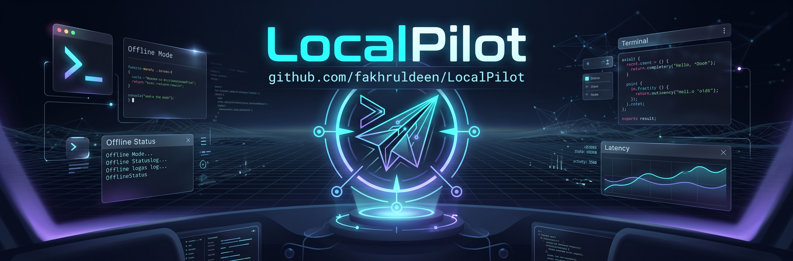

<div align="center">



# LocalPilot

**Local AI, Made Simple.**

**[English](README.md)** • **[العربية (Arabic)](README.ar.md)**

[](https://pypi.org/project/localpilot/)
[](https://pypi.org/project/localpilot/)
[](https://www.gnu.org/licenses/gpl-3.0)
[](https://doi.org/10.5281/zenodo.23424540)
[](https://fakhr.me/LocalPilot/)
[](https://fakhr.me/LocalPilot/)

*Find an AI that fits your computer, set it up safely, and help you use it.*

[Website](https://fakhr.me/LocalPilot/) • [Beginner Guide](https://fakhr.me/LocalPilot/guide.html) • [Model Catalog](https://fakhr.me/LocalPilot/models.html) • [FAQ](https://fakhr.me/LocalPilot/faq.html) • [Technical Architecture](https://fakhr.me/LocalPilot/architecture.html) • [التوثيق بالعربية](docs/ar/README.md) • [PyPI](https://pypi.org/project/localpilot/) • [DOI](https://doi.org/10.5281/zenodo.23424540)

</div>

---

## 🌟 Why LocalPilot?

Running local AI shouldn't require configuring build flags, figuring out CUDA or Metal layer offloading, calculating KV-cache bytes, or manually nursing broken environment variables.

**LocalPilot** is a friendly, hardware-aware Python application that guides you from discovery to chat. It inspects your real hardware capabilities, scores models based on verified compatibility, sets up runtimes with safe defaults, and monitors resource usage in a calm, full-screen terminal dashboard or intuitive CLI.

---

## ✨ Key Features

- **🧠 Hardware-Aware Recommendation**: Evaluates CPU, RAM, GPU, Apple Silicon Unified Memory vs. discrete VRAM, and storage budgets. Filters out incompatible models before you waste bandwidth.
- **🧭 3-Axis Execution Architecture**: Decouples model computation into three orthogonal dimensions:
  - **Inference Backends**: `llama.cpp` (GGUF, Metal, CUDA), `vLLM` (advanced Linux+GPU).
  - **Managed Execution Services**: `Ollama`, `LM Studio / llmster`, and `Docker Model Runner`.
  - **Deployment Methods**: Direct isolated worker processes (`direct_worker`), local API services (`local_api_service`), and containers.
- **🛡️ External Service & Data Protection**:
  - Respects external daemons: unloads models from memory (`keep_alive=0` / `/v1/models/unload`) without killing shared background services.
  - Reference-counted storage protects your model files and never deletes unowned files.
- **📦 Multi-Scope Installation**: Choose between **Application-Isolated** (default, no root needed), **User-Space** (`~/.local/bin`), or **System-Wide** (`/usr/local/bin`).
- **💻 Dual Interface**:
  - **Interactive TUI**: A beautiful full-screen dashboard powered by [Textual](https://textual.textualize.io/).
  - **Fast Scriptable CLI**: Clean, structured CLI commands powered by [Typer](https://typer.tiangolo.com/) and [Rich](https://rich.readthedocs.io/).
- **📝 Comprehensive Observability**: Structured event logs, audit checkpoints before destructive actions, and support bundle diagnostics.

---

---

## 🚀 Installation & Quick Start

Choose the method that fits your computer:

### Option 1: Automated Shell Installer (Recommended for Non-Technical Users)
No need to configure Python virtual environments or paths manually:
```bash
curl -fsSL https://raw.githubusercontent.com/fakhruldeen/LocalPilot/main/install-localpilot.sh | bash
```

### Option 2: With `pipx` (Recommended for Python CLI Users)
```bash
pipx install localpilot
```

### Option 3: With `pip` or `uv`
```bash
pip install localpilot
# or
uv tool install localpilot
```

👉 *For advanced flags, custom scopes, and uninstallation instructions, see the **[Installation Guide](docs/INSTALLATION.md)**.*

---

## 🧠 New to Local AI? Read This First

If terms like *inference backends*, *weights*, *VRAM*, *Ollama*, or *Docker* seem confusing, read our friendly **[Beginner's Guide to Local AI](docs/CONCEPTUAL_GUIDE.md)**.

In short:
- **Model Weights**: A large data file containing learned knowledge (like a book).
- **Inference Backend** (e.g. `llama.cpp`, `vLLM`): The computational engine that does the math on your CPU or GPU (like the reader).
- **Execution Service** (e.g. `Ollama`, `LM Studio`, `Docker`): Optional background daemons that manage models and local APIs.
- **Why LocalPilot?**: You don't have to manually match engines, calculate memory bytes, or troubleshoot Docker. LocalPilot inspects your machine, selects the optimal plan automatically, and reuses any tools you already have installed!

## 🎮 Usage Guide

### Launch the Terminal Dashboard (TUI)
Simply type:
```bash
localpilot
```
Use keyboard shortcuts to navigate:
- <kbd>d</kbd> Find compatible models
- <kbd>i</kbd> View installed models
- <kbd>r</kbd> View running models & resource usage
- <kbd>s</kbd> Inspect managed storage
- <kbd>a</kbd> Activity and decision history
- <kbd>q</kbd> Exit

---

### Command-Line Interface (CLI)

#### 1. Inspect Your Computer's Hardware
```bash
localpilot doctor
```
Audits CPU cores, available RAM, memory safety thresholds, hardware acceleration (Metal on Mac, CUDA on Linux), and active background services.

#### 2. Discover Compatible Models
```bash
# List all models verified to fit your memory safely
localpilot discover

# Filter by task or search query
localpilot discover --task chat
localpilot discover -q "llama"
```

#### 3. Guided Model Setup
```bash
localpilot setup <candidate-id>
```
Downloads real weights, validates SHA-256 integrity, configures local runtime adapters, and executes automated smoke inference before marking the model ready.

#### 4. Instant Offline Chat
```bash
localpilot chat <candidate-id-or-model-id>
```
Launches an immediate private conversation. When you exit with `/exit` or <kbd>Ctrl + C</kbd>, memory is instantly returned to your operating system.

#### 5. Inventory & Process Inspection
```bash
# View installed models on this computer
localpilot installed

# View active running models and memory consumption
localpilot running
```

#### 6. Storage Inspection & Safe Removal
```bash
# View storage breakdown across weights and databases
localpilot storage

# Safely remove a model and reclaim disk space
localpilot remove <installation-id> --delete-files
```

#### 7. Application Updates & Support
```bash
# Check PyPI and update LocalPilot application
localpilot self update

# Generate an anonymized diagnostic report for troubleshooting
localpilot support

# Cleanly uninstall LocalPilot and optionally purge stored models
localpilot self uninstall --purge-models
```

---

## 🌍 Arabic Documentation (التوثيق باللغة العربية)

LocalPilot provides first-class documentation in Arabic for Arabic-speaking users and researchers:

- 📖 **[ملف القراءة بالعربية (Arabic README)](README.ar.md)**: نظرة شاملة على المشروع والمميزات ودليل الأوامر.
- 🚀 **[دليل البدء السريع (Quickstart)](docs/ar/QUICKSTART.md)**: خطوات التثبيت والتشغيل في أقل من دقيقتين.
- 🧠 **[دليل المفاهيم الأساسية (Conceptual Guide)](docs/ar/CONCEPTUAL_GUIDE.md)**: شرح مبسط لمفاهيم الأوزان والذاكرة والنماذج المحلية.
- 📚 **[فهرس التوثيق العربي (Arabic Docs Index)](docs/ar/README.md)**: الفهرس الرئيسي للأدلة والموارد العربية.

---

## 📐 Architecture Overview

```text
Application Services (CLI / TUI / Setup / Chat)
                    │
                    ▼
          ┌───────────────────┐
          │   ExecutionPlan   │
          └─────────┬─────────┘
                    │
   ┌────────────────┼────────────────┐
   ▼                ▼                ▼
Backend          Service         Deployment
llama.cpp        Ollama          direct_worker
vLLM             LM Studio       local_api_service
                 Docker Runner   container
```

For full details on platform compatibility and supported backend/service combinations, see the **[Support Matrix](docs/SUPPORT_MATRIX.md)** and the **[Technical Architecture Manual](https://fakhr.me/LocalPilot/architecture.html)**.

---

## 👤 Author & Maintainer

**Mohamed Fouad Fakhruldeen**  
*Creator & Maintainer of LocalPilot. Working across PMO governance, AI systems, and agile enterprise operating systems.*

- 🌐 **Website**: [fakhr.me](https://fakhr.me/)
- 💼 **LinkedIn**: [linkedin.com/in/fakhruldeen](https://www.linkedin.com/in/fakhruldeen)
- 🐙 **GitHub**: [@fakhruldeen](https://github.com/fakhruldeen)
- 📬 **Email**: fakhruldeen@gmail.com

---

## ⚠️ Disclaimer

> [!WARNING]
> **Personal Use & Testing Only**: LocalPilot is intended for non-professional and hobbyist exploration. Local model execution involves fast-moving, cutting-edge technologies that typically require specialized knowledge and ongoing training to configure and operate reliably.
>
> This project is provided strictly on an **"AS-IS"** basis for personal evaluation, experimentation, and research purposes. It is **NOT** designed, validated, or certified for production environments, mission-critical infrastructure, or commercial deployments. The creator and maintainer assume **no liabilities, warranties, or legal responsibilities** whatsoever for any data loss, system instability, hardware stress, service disruptions, or issues arising from the use or misuse of this software in production or any other context.

---

## 📚 Citation

If you use LocalPilot in your research, academic study, or open-source projects, please cite it as:

```bibtex
@software{fakhruldeen_2026_localpilot,
  author       = {Mohamed (Fouad) Fakhruldeen},
  title        = {fakhruldeen/LocalPilot: v0.1.1},
  month        = oct,
  year         = 2026,
  publisher    = {Zenodo},
  version      = {v0.1.1},
  doi          = {10.5281/zenodo.23424540},
  url          = {https://doi.org/10.5281/zenodo.23424540}
}
```

**Text / APA Citation:**
> Mohamed (Fouad) Fakhruldeen. (2026). fakhruldeen/LocalPilot: v0.1.1 (Version v0.1.1) [Computer software]. Zenodo. https://doi.org/10.5281/zenodo.23424540

---

## 📄 License

This project is licensed under the terms of the **GNU General Public License v3 (GPLv3)**. See the [LICENSE](LICENSE) file for details.
