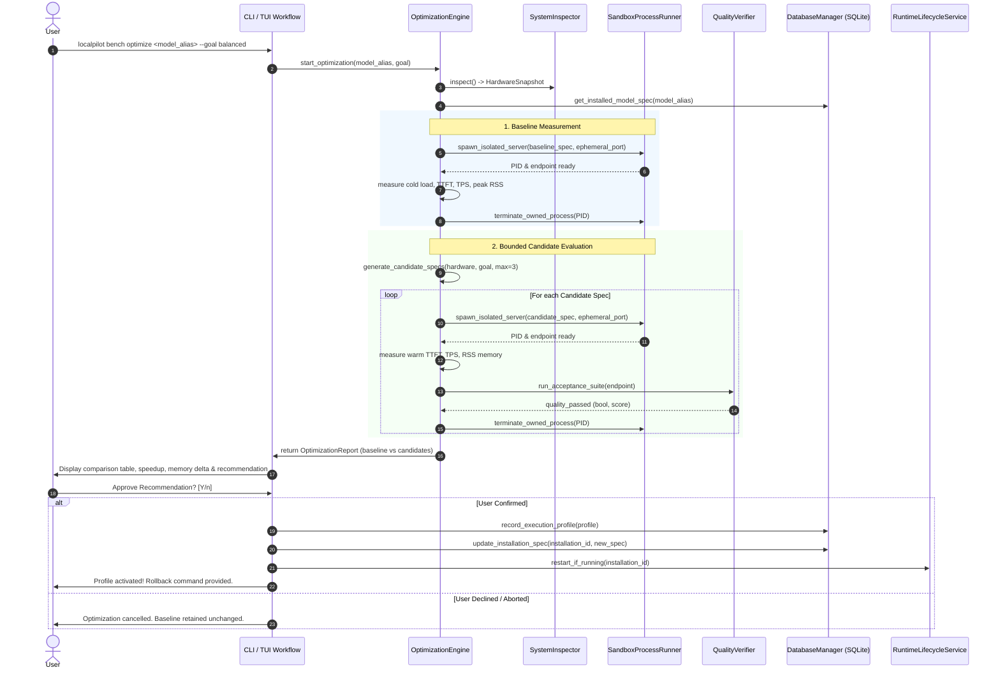

# Hardware-Aware Local-Model Optimization Implementation Plan

## Goal Description

LocalPilot allows users to discover, install, run, and manage private offline LLMs across diverse consumer hardware. Currently, model execution relies on default runtime flags (e.g., standard context window, fixed CPU threads, or binary GPU offload guesses). While the codebase includes hardware inspection ([`SystemInspector`](file:///home/mohamed/Desktop/LocalPilot/src/localpilot/hardware/inspector.py#L54)), an immutable execution spec ([`ExecutionSpecification`](file:///home/mohamed/Desktop/LocalPilot/src/localpilot/domain/execution_plan.py#L116)), and an early latency/throughput benchmark service ([`BenchmarkService`](file:///home/mohamed/Desktop/LocalPilot/src/localpilot/application/benchmark_service.py#L31)), it lacks an automated, safety-bounded optimization workflow to tune runtime execution settings for a user's specific CPU, GPU, and RAM environment.

This plan defines an **opt-in, non-destructive, hardware-aware optimization workflow**:
```
Inspect Hardware & Baseline
  -> Measure Cold/Warm Baseline
  -> Identify Supported Candidate Settings
  -> Test in Isolated Owned Sandbox (Bounded Time & Memory)
  -> Check Task Quality & Stability (Deterministic Gates)
  -> Recommend Best Profile (Balanced / Faster / Lower Memory)
  -> Obtain Explicit User Approval
  -> Persist Profile & Apply Specification
  -> Continuous Health Check with Instant Rollback
```

---

## User Review Required

> [!IMPORTANT]
> **Zero Model Replacement Guarantee**: Optimization tunes **execution parameters for the user's currently installed model artifact** (e.g., CPU thread allocation, GPU offload layers, KV cache precision, context sizing). It **never** silently swaps models, alters quantization, downloads new weights, shortens context silently, or changes prompts to fabricate performance gains.

> [!WARNING]
> **Isolated Owned Execution Only**: In the first release, optimization targets the **`llamacpp` (llama-server)** runtime. Unlike Ollama (which runs a persistent global daemon that may be shared by other external tools or system services), `llama-server` instances can be spawned on an ephemeral port in an isolated, LocalPilot-owned process sandbox (`OwnershipClass.LOCALPILOT_OWNED`). The user's active model service remains undisturbed until they review and approve the recommended profile.

---

## A. Current-State Summary with Repository Evidence

An audit of the existing codebase reveals strong foundations for hardware inspection, execution planning, process ownership, and persistence:

1. **Hardware Inspection & Platform Abstraction**:
   - [`SystemInspector`](file:///home/mohamed/Desktop/LocalPilot/src/localpilot/hardware/inspector.py#L54): Inspects CPU cores (physical & logical), CPU instruction features (AVX2, AVX512, NEON), RAM totals, free memory, disk space, and GPU devices (VRAM, driver version, acceleration type: CUDA, ROCm, Metal, Vulkan, CPU).
   - [`HardwareSnapshot`](file:///home/mohamed/Desktop/LocalPilot/src/localpilot/platforms/base.py#L24): Provides structured hardware state including [`safe_ram_budget_bytes`](file:///home/mohamed/Desktop/LocalPilot/src/localpilot/platforms/base.py#L38) and [`safe_vram_budget_bytes`](file:///home/mohamed/Desktop/LocalPilot/src/localpilot/platforms/base.py#L39).

2. **Execution Specification & Process Ownership**:
   - [`ExecutionSpecification`](file:///home/mohamed/Desktop/LocalPilot/src/localpilot/domain/execution_plan.py#L116): Canonical, immutable dataclass containing `offload_layers`, `context_window`, `concurrency`, `required_memory_budget_bytes`, and `requested_execution_mode`. Persisted in SQLite `installations.execution_spec_json`.
   - [`OwnershipVerifier`](file:///home/mohamed/Desktop/LocalPilot/src/localpilot/domain/ownership.py): Enforces that LocalPilot only manages and terminates processes with verified `ProcessIdentity` matching its own PID and process creation timestamp (`OwnershipClass.LOCALPILOT_OWNED`). It strictly forbids killing foreign or unverified PIDs.
   - [`RuntimeLifecycleService`](file:///home/mohamed/Desktop/LocalPilot/src/localpilot/application/runtime_service.py#L28): Starts installed models via adapters and reconciles live OS processes against database records.

3. **Runtime Adapters & Parameter Controls**:
   - [`LlamaCppRuntimeAdapter`](file:///home/mohamed/Desktop/LocalPilot/src/localpilot/runtimes/llamacpp.py#L37): Launches `llama-server` on an ephemeral localhost port with `-m`, `-c`, `-ngl`, and `-np`. Environment configuration (`LD_LIBRARY_PATH` / `DYLD_LIBRARY_PATH`) is managed in [`get_runtime_env`](file:///home/mohamed/Desktop/LocalPilot/src/localpilot/runtimes/llamacpp.py#L63).
   - [`OllamaRuntimeAdapter`](file:///home/mohamed/Desktop/LocalPilot/src/localpilot/runtimes/ollama.py#L33): Launches or attaches to a single global daemon (`ollama serve`) on `127.0.0.1:11434`. Execution parameters are passed at inference or via Modelfiles.

4. **Benchmarking & Quality Foundations**:
   - [`BenchmarkService`](file:///home/mohamed/Desktop/LocalPilot/src/localpilot/application/benchmark_service.py#L31): Executes live streaming requests against `/chat/completions` to measure Time-to-First-Token (TTFT), Tokens-per-Second (TPS), and total duration over standardized suites (`general`, `coding`, `speed`). Persists to `benchmark_runs` table.
   - [`TaskService`](file:///home/mohamed/Desktop/LocalPilot/src/localpilot/application/task_service.py): Runs specific tasks (e.g., text summarization, code generation) through the local API gateway.

5. **Persistence Schema**:
   - SQLite tables in [`DatabaseManager`](file:///home/mohamed/Desktop/LocalPilot/src/localpilot/storage/db.py):
     - `installations` (tracks `execution_spec_json`, `execution_plan_json`, `runtime_name`).
     - `execution_profiles` (schema v4: `profile_id`, `version_id`, `profile_name`, `backend`, `threads`, `gpu_layers`, `context_tokens`, `temperature`).
     - `benchmark_runs` (schema v6: `run_id`, `model_alias`, `ttft_ms`, `tps`, `total_duration_ms`, `peak_memory_mb`, `raw_metrics_json`).
     - `verification_records` (schema v4: `verification_id`, `version_id`, `profile_id`, `passed`, `benchmark_tps`, `first_token_latency_ms`, `observed_metrics`).
     - `alias_history` (tracks previous and new version/profile pointers for instant rollback).

---

## B. Existing vs. Proposed Capability Matrix

| Capability Area | Existing Codebase State | Classification | Proposed Optimization Enhancement |
| :--- | :--- | :--- | :--- |
| **Hardware Inspection** | Probes CPU cores, features, RAM, disk, GPU VRAM & acceleration via `SystemInspector`. | **Implemented & Verified** | Reuse as-is; capture hardware fingerprint hash to detect profile staleness. |
| **Execution Spec** | Immutable `ExecutionSpecification` governing offload layers, context, memory budget. | **Implemented & Verified** | Add fields: `threads`, `flash_attention`, `kv_cache_precision`, `batch_size`. |
| **Process Ownership** | `OwnershipVerifier` validates PID + creation time; forbids touching external processes. | **Implemented & Verified** | Enforce strictly in sandbox executor: only spawn & kill owned sandbox PIDs. |
| **Benchmarking Service** | Measures TTFT & TPS via HTTP streaming in `BenchmarkService`. | **Implemented & Verified** | Enhance to capture cold load time, decode TPS vs prompt eval TPS, and peak RSS memory. |
| **Hardware-Aware Parameter Generation** | Only binary offload guess (`offload_layers = 99` if GPU else `0`). No thread or cache tuning. | **Partially Implemented** | Add `OptimizationCandidateGenerator` producing bounded parameter sets for user hardware. |
| **Execution Profiles Persistence** | `execution_profiles` table exists in DB schema v4, but lacks rich metric linkages and activation logic. | **Partially Implemented** | Integrate with `ModelVersionService` and `RuntimeLifecycleService` to store tested metrics & rollback pointers. |
| **Quality & Stability Verification** | `test_inference` checks simple HTTP 200 ping. No deterministic task verification. | **Partially Implemented** | Add deterministic quality gates: unit-test code execution, JSON schema adherence, known-answer extraction. |
| **Optimization CLI & TUI** | `bench run`, `bench compare`, `bench results` exist in CLI. No `optimize` command or TUI wizard. | **Missing** | Implement `localpilot bench optimize` (with alias `localpilot optimize`) and interactive TUI modal. |
| **Automated Profile Rollback** | `alias_history` table exists in DB schema v4, but lacks one-click CLI/TUI profile restoration. | **Partially Implemented** | Implement `localpilot profiles apply` and `localpilot profiles rollback`. |

---

## C. Smallest Viable Feature Scope (Phase 1)

### Why `llamacpp` (`llama-server`) for Phase 1?
1. **Full Process Sandboxing**: `llama-server` is executed directly by LocalPilot via `subprocess.Popen` on an ephemeral localhost port (`find_free_port()`). LocalPilot possesses 100% process ownership (`OwnershipClass.LOCALPILOT_OWNED`). It can launch test candidate instances in complete isolation without disturbing the user's running models, main gateway, or external processes.
2. **Fine-Grained Runtime Tuning Flags**:
   - `-t, --threads <N>`: Configures CPU thread pool.
   - `-ngl, --n-gpu-layers <N>`: Adjusts offload depth between 0 (pure CPU) and total layers (full VRAM).
   - `-c, --ctx-size <N>`: Allocates exact context window without guessing.
   - `-fa, --flash-attn`: Toggles Flash Attention kernel on supported compute hardware.
   - `--cache-type-k <type>`, `--cache-type-v <type>`: Selects KV cache quantization (`f16`, `q8_0`, `q4_0`).
3. **No Global State Pollution**: Unlike Ollama, which requires updating global Modelfiles or modifying persistent server configuration on port 11434, `llama-server` candidates are 100% ephemeral command-line instances.

### Explicit Non-Goals for the Initial Scope:
- **No Training or Fine-Tuning**: Tuning is runtime-parameter execution optimization only.
- **No Automatic Model Replacement**: The model artifact (weights file) remains identical.
- **No Silent Quantization Swapping**: Does not switch between Q4_K_M and Q8_0 or change model files.
- **No Automatic Downloads**: Optimization operates strictly on locally installed models.
- **No Exhaustive Grid Searches**: Tests a maximum of 3 to 4 viable candidates based on detected hardware capacity.
- **No Off-Device Telemetry or Cloud Evaluation**: All tests and validations run strictly locally.

---

## D. Architecture & Data Flow



---

## E. Phased Implementation Backlog

### Phase 0: Audit, Foundations & Contract Refinement
- **Objective**: Establish domain data contracts for optimization candidates, hardware constraints, and profile linkages without changing existing application behavior.
- **Components to Reuse**:
  - [`SystemInspector`](file:///home/mohamed/Desktop/LocalPilot/src/localpilot/hardware/inspector.py)
  - [`HardwareSnapshot`](file:///home/mohamed/Desktop/LocalPilot/src/localpilot/platforms/base.py)
  - [`ExecutionSpecification`](file:///home/mohamed/Desktop/LocalPilot/src/localpilot/domain/execution_plan.py)
- **Proposed Extensions**:
  - Add optional execution fields to [`ExecutionSpecification`](file:///home/mohamed/Desktop/LocalPilot/src/localpilot/domain/execution_plan.py#L116):
    - `cpu_threads: Optional[int] = None`
    - `flash_attention: bool = False`
    - `kv_cache_type: str = "f16"` (options: `f16`, `q8_0`, `q4_0`)
    - `batch_size: int = 512`
  - Define `OptimizationGoal` enum (`BALANCED`, `FASTER_RESPONSES`, `LOWER_MEMORY`).
  - Define `CandidateEvaluationResult` and `OptimizationReport` dataclasses.
- **Affected Files**:
  - `src/localpilot/domain/execution_plan.py`
  - `src/localpilot/domain/versioning.py`
  - `src/localpilot/domain/task_contract.py`
- **Acceptance Criteria**: All existing tests pass (`pytest tests/`); existing `ExecutionSpecification` instances serialize/deserialize with backward compatibility.

### Phase 1: Read-Only Baseline Measurement & Isolated Sandbox Runner
- **Objective**: Provide a safe, isolated mechanism to measure cold/warm latency, throughput, and memory of the currently installed model without altering active services.
- **Components to Reuse**:
  - [`LlamaCppRuntimeAdapter`](file:///home/mohamed/Desktop/LocalPilot/src/localpilot/runtimes/llamacpp.py)
  - [`OwnershipVerifier`](file:///home/mohamed/Desktop/LocalPilot/src/localpilot/domain/ownership.py)
  - [`BenchmarkService`](file:///home/mohamed/Desktop/LocalPilot/src/localpilot/application/benchmark_service.py)
- **Proposed Extensions**:
  - Create `src/localpilot/application/optimization/sandbox.py`:
    - `IsolatedSandboxRunner`: Spawns `llama-server` on a dynamic port returned by `find_free_port()`, redirects stdout/stderr to an isolated test log (`instance-opt-sandbox.log`), captures PID with `OwnershipClass.LOCALPILOT_OWNED`, waits for HTTP `/v1/models` readiness, and reliably cleans up via `psutil` `terminate()` / `kill()` upon completion or cancellation.
  - Implement memory monitoring: Use `psutil.Process(pid).memory_info().rss` to track baseline process memory footprint.
- **Affected Files**:
  - `src/localpilot/application/optimization/sandbox.py` (new)
  - `src/localpilot/application/benchmark_service.py`
- **Acceptance Criteria**: Running a baseline test launches on an ephemeral port, records cold startup time, TTFT, TPS, and peak RSS, and terminates the test process with zero orphaned processes.

### Phase 2: Bounded Candidate Generation & Safety Limits
- **Objective**: Generate a strictly bounded set of candidate runtime parameters (maximum 3-4) matching the user's hardware snapshot and chosen optimization goal.
- **Tuning Dimension Rules**:
  1. **CPU Threads (`-t`)**:
     - Baseline: Default (typically logical cores or 4).
     - Candidate: Set to physical CPU cores (`cpu_cores_physical`), preventing hyperthreading resource contention and context switching overhead.
  2. **GPU Layer Offload (`-ngl`)**:
     - For dedicated GPUs: Step from current offload to maximum layers fitting within `safe_vram_budget_bytes`.
     - For Unified Memory (Apple Silicon): Offload all layers (`999`) if model fits within unified memory budget.
     - For CPU-only systems: Keep `ngl = 0`.
  3. **Flash Attention (`-fa`)**:
     - Enable if CPU has AVX2/NEON or GPU compute capability supports it.
  4. **KV Cache Precision (`--cache-type-k`, `--cache-type-v`)**:
     - For `LOWER_MEMORY` goal: Test `q8_0` or `q4_0` (reducing KV RAM by 50-75% with negligible perplexity shift).
     - For `BALANCED` / `FASTER_RESPONSES`: Retain `f16`.
- **Safety Checks**:
  - Memory headroom: Reject any candidate whose projected memory exceeds `ram_available_bytes - 1GB`.
  - Max duration: Cap total optimization run to 120 seconds (30s per candidate).
  - Timeout: Individual request timeout set to 15 seconds.
- **Affected Files**:
  - `src/localpilot/application/optimization/candidate_generator.py` (new)
  - `src/localpilot/application/optimization/engine.py` (new)
- **Acceptance Criteria**: Never generates more than 4 candidates. Rejects configurations exceeding safety RAM/VRAM budgets.

### Phase 3: Task-Quality & Stability Verification Gates
- **Objective**: Ensure that tuning parameters did not destabilize the model or produce corrupted outputs.
- **Deterministic Quality Gates**:
  1. **Syntax / Code Correctness**:
     - Prompt model to generate a simple function (e.g., palindrome check).
     - Validate output parses via Python `ast.parse()` or matches expected structural signature.
  2. **JSON / Structured Output Adherence**:
     - Prompt model to extract entities into JSON `{"status": "ok", "count": 3}`.
     - Validate output parses via `json.loads()` and contains required keys.
  3. **Instruction Following / Substring Check**:
     - Standardized reasoning prompt with a known ground-truth answer.
     - Verify ground truth appears in the output.
- **Quality Score Calculation**: Candidate must score 100% on safety/smoke tests and >= baseline on instruction adherence. Any crash, segfault, NaN generation, or JSON syntax failure immediately marks the candidate as `REJECTED`.
- **Affected Files**:
  - `src/localpilot/application/optimization/quality_verifier.py` (new)
  - `src/localpilot/application/optimization/engine.py`
- **Acceptance Criteria**: Corrupted or failing candidate runs are flagged with detailed error explanations and never presented as recommendations.

### Phase 4: Saved Profiles, User Approval, Activation & Rollback
- **Objective**: Allow users to review a side-by-side comparison, explicitly confirm profile activation, and restore the previous configuration at any time.
- **Persistence & Profile Management**:
  - Store winning profile in `execution_profiles` table.
  - Link installation to `profile_id` and update `execution_spec_json`.
  - Record previous spec in `alias_history` / `installation_history` for rollback.
- **CLI Commands**:
  - `localpilot bench optimize <model_alias> [--goal balanced|speed|memory] [--dry-run]`
  - `localpilot profiles list [model_alias]`
  - `localpilot profiles apply <model_alias> <profile_id>`
  - `localpilot profiles rollback <model_alias>`
- **TUI Integration**:
  - Add "Optimize Model" action in Installed Models screen.
  - Render an interactive step-by-step modal showing live progress, benchmark comparison table, and an explicit `[Apply Profile]` / `[Cancel]` prompt.
- **Affected Files**:
  - `src/localpilot/cli/main.py`
  - `src/localpilot/tui/app.py`
  - `src/localpilot/application/version_service.py`
- **Acceptance Criteria**: Activation requires user confirmation. Rollback restores the previous `ExecutionSpecification` in < 1 second.

### Phase 5: Additional Settings & Multi-Runtime Expansion (Future / Optional)
- **Objective**: Extend parameter tuning to Ollama (via Modelfile generation and runtime options payload) and vLLM (via GPU memory utilization and tensor parallelism).
- **Condition**: Only executed after Phase 1-4 are verified in production.

---

## F. Measurement and Quality Strategy

### 1. Timing Boundaries & Metrics Provenance
- **Cold Load Time**: Measured from `subprocess.Popen` execution until HTTP 200 is received on `GET /v1/models`.
- **Time to First Token (TTFT)**: Measured from the instant the POST request is sent until the first SSE chunk (`data: {"choices": [{"delta": ...}]}`) arrives over the socket.
- **Tokens per Second (TPS)**:
  - **Prompt Evaluation (Prefill) TPS**: Observable from runtime server logs or measured via `(prompt_tokens / prefill_duration)`.
  - **Generation (Decode) TPS**: Calculated strictly as `completion_tokens / (t_completion_done - t_first_token)`.
- **Peak Process Memory**: Polled every 100ms via `psutil.Process(pid).memory_info().rss` during active generation.
- **Repeated Runs**: Each candidate runs 2 warm iterations after 1 cold probe; metrics report the mean and standard deviation.

### 2. Standardized Evaluation Prompts
```python
OPTIMIZATION_BENCHMARK_PROMPTS = {
    "smoke": "Respond with the word 'READY' and nothing else.",
    "coding": "Write a Python function named `is_palindrome(s: str) -> bool` that returns True if s is a palindrome.",
    "json_structure": "Return a JSON object with keys 'city' and 'country' for Tokyo.",
    "reasoning": "A farmer has 17 sheep. All but 9 run away. How many sheep does the farmer have left? Give just the number."
}
```

---

## G. Safety, Compatibility, Privacy, and Rollback Rules

1. **Safety & Resource Guards**:
   - **Pre-flight RAM Check**: Optimization will not begin if system available RAM is below 2.0 GB.
   - **Process Isolation**: The test sandbox never shares a port with an existing instance.
   - **Guaranteed Cleanup**: Uses Python context managers (`try...finally`) wrapping process lifecycles. On SIGINT or unexpected crash, child processes are terminated immediately via PID tracking.
2. **External Process Preservation**:
   - LocalPilot checks `OwnershipVerifier.verify_process(identity)`. It will never kill or signal external Ollama daemons, system services, or foreign processes.
3. **Privacy**:
   - Prompts and generated text during optimization remain strictly local on the machine.
   - Metrics logs redact any prompt text and record only numerical performance statistics and test pass/fail codes.
4. **Instant Rollback**:
   - Every profile application backs up the existing `execution_spec_json` to `alias_history`.
   - Running `localpilot profiles rollback <model>` immediately restores the previous spec and signals the running service.

---

## H. Acceptance Criteria and Regression Coverage

### Automated Test Matrix
1. **Unit Tests**:
   - `test_candidate_generator_cpu_only`: Confirms thread calculation targets physical cores and offload layers remain 0 on non-GPU hardware.
   - `test_candidate_generator_gpu`: Confirms offload layers do not exceed GPU VRAM budget.
   - `test_quality_verifier`: Validates syntax parsing and JSON adherence checking logic with mock outputs.
   - `test_profile_serialization`: Verifies `ExecutionProfile` and `ExecutionSpecification` round-trip through SQLite schema.
2. **Integration Tests (Mocked Runtimes)**:
   - `test_sandbox_lifecycle`: Tests that `IsolatedSandboxRunner` spawns mock server, measures latency, and guarantees process termination.
   - `test_optimization_engine_flow`: Runs full `OptimizationEngine.optimize()` flow with mock generator, producing expected comparison reports.
   - `test_cli_optimize_dry_run`: Verifies `localpilot bench optimize --dry-run` prints comparison table without altering active database spec.
   - `test_rollback_workflow`: Applies a profile and tests rollback command, verifying database spec returns to original state.

---

## I. Risks, Uncertainties, and Decisions Requiring Approval

1. **GPU Offload Precision in llama.cpp**:
   - *Risk*: `-ngl <N>` layer distribution depends on model architecture (e.g., 32 layers for 7B, 40 layers for 14B).
   - *Mitigation*: Inspect model metadata from GGUF header or estimate safely using `total_bytes / layer_count`.
2. **Flash Attention Support**:
   - *Risk*: Older CPUs without AVX2 or older GPUs may fail or crash if `-fa` is passed.
   - *Mitigation*: Probe CPU features from `HardwareSnapshot.cpu_features` before offering Flash Attention candidates.
3. **Background System Load Variations**:
   - *Risk*: User running other applications during optimization can skew benchmark measurements.
   - *Mitigation*: Run 2 warm rounds, report standard deviation, and warn user if background CPU utilization is high prior to starting.

---

## J. Non-Goals for Initial Release

- Automatic background optimization during general chat or model installation.
- Quantization format conversion or downloading alternate GGUF files.
- Fine-tuning or parameter modification (weights modification).
- Modifying system-level driver configurations or elevating sudo privileges.
- Support for distributed/multi-node clusters.

---

## Recommended Next Implementation Task

When approved, the smallest and safest first implementation task is:
> **Task 1: Implement the Domain Contracts and Parameter Generator (`OptimizationEngine` interfaces, `OptimizationGoal`, and `candidate_generator.py`) along with comprehensive unit tests.**
> This introduces the mathematical and hardware-constrained candidate generation logic without spawning processes or altering existing workflows.
